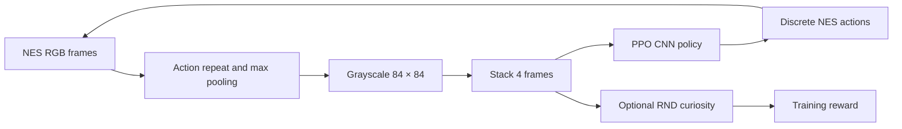
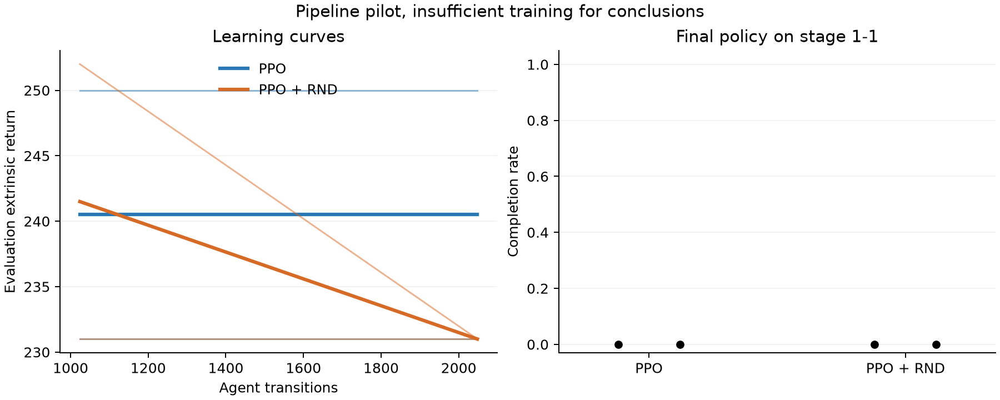

# Mario Pixel RL

A student reinforcement learning project that trains a visual agent to play **Super Mario Bros.** using PPO, with optional curiosity and collection rewards.

The project explores how reward design changes what an agent learns: progressing through a level, collecting points and coins, or visiting unfamiliar states. PPO optimization is provided by **Stable-Baselines3**. The custom work covers the environment wrappers, reward shaping, RND integration, experiment records, and evaluation tools.

## Trained gameplay

Historical agents trained for millions of transitions cleared stage 1-1 and reached
stage 1-2. The strongest archived recording shows a game score of 28,050.


Fresh checkpoint evaluations are documented in [the historical results](results/historical/README.md).
These demonstrate trained gameplay. The short PPO-versus-RND pilot below checks a
separate experiment workflow.

## Approach

The policy sees only rendered images. Game-state fields are used for evaluation and, when enabled, collection and coverage rewards. This is visual control with optional state-informed rewards.



- **PPO:** NatureCNN features, categorical action policy, and a value head.
- **Collection rewards:** bonuses for score gains, coins, and power-ups.
- **Coverage:** a bonus for entering a new 16-pixel spatial cell within an episode.
- **RND:** prediction error against a frozen random network encourages unfamiliar visual states.

The RND implementation uses online predictor updates and a single PPO value head for the combined reward. It is a simplified implementation, rather than a reproduction of every detail in the original paper. See [the algorithm guide](docs/RL_ALGORITHM.md) for equations, wrapper ordering, and implementation details.

## Setup

The pinned environment stack requires **Python 3.13 or later**. A clean installation, tests, and emulator integration checks have been run on macOS Apple Silicon with Python 3.13. On macOS, building `nes-py` may require Xcode Command Line Tools.

With [uv](https://docs.astral.sh/uv/):

```bash
uv venv --python 3.13 .venv
source .venv/bin/activate
uv pip install -e '.[dev]'
```

Or with Python and pip:

```bash
python3.13 -m venv .venv
source .venv/bin/activate
python -m pip install -e '.[dev]'
```

This repository does not include ROM files. The registered environments are supplied by `gym-super-mario-bros`. Review that package's assets and licensing before using or distributing them.

## Train

Start with a short pipeline check:

```bash
python -m src.train --config configs/ppo_world1_1.yaml --smoke
```

Smoke runs use separate directories under `runs/ppo_world1_1/smoke/`. Normal runs get timestamped directories under `runs/ppo_world1_1/experiments/`. Each run contains its resolved configuration, metadata, checkpoints, evaluation logs, and final model.

For an explicit experiment directory:

```bash
python -m src.train --config configs/ppo_world1_1.yaml \
  --run-dir runs/baseline_seed0
```

Fresh training refuses to overwrite a nonempty run directory. Change the seed and settings in YAML for another experiment. `total_timesteps` counts agent transitions across all environments, rather than raw emulator frames.

| Configuration | Environment | Reward additions | Actions |
|---|---|---|---|
| `ppo_world1_1.yaml` | Stage 1-1 | None | 7 |
| `ppo_human.yaml` | Stage 1-1 | Collection + RND | 7 |
| `ppo_human_1_2.yaml` | Stage 1-2 | Collection + RND | 7 |
| `ppo_fullgame.yaml` | Continuous stages | Collection + coverage + RND | 7 |
| `ppo_explore.yaml` | Continuous stages | Collection + coverage + RND | 12 |

The legacy `humanlike` configuration flag enables collection rewards. Human-like behavior has not been established experimentally.

### Resume and transfer

```bash
# Continue a particular run. YAML supplies the additional transition budget.
python -m src.train --config runs/baseline_seed0/config.yaml \
  --resume runs/baseline_seed0/final_model.zip

# Start a new run using pretrained policy weights and a fresh optimizer.
python -m src.train --config configs/ppo_human_1_2.yaml \
  --init-from runs/baseline_seed0/final_model.zip \
  --run-dir runs/transfer_1_2
```

Resume restores saved PPO settings and optimizer state. The requested YAML and actual PPO settings are recorded separately in metadata. Curiosity-enabled checkpoints also require their matching `.rnd.pt` file. Older checkpoints without that file can be used to warm-start a fresh run.

`--transfer-from` copies only tensors with matching names and shapes, supporting changes such as a larger action space. Matching tensor shapes do not guarantee matching action meanings. Neither resume nor transfer restores emulator state or promises an identical continuation trajectory.

## Evaluate and watch

Use the configuration saved in the run:

```bash
python -m src.evaluate --config runs/baseline_seed0/config.yaml \
  --model runs/baseline_seed0/final_model.zip --episodes 5 \
  --metrics runs/baseline_seed0/evaluation.json \
  --video runs/baseline_seed0/gameplay.mp4

python -m src.watch --config runs/baseline_seed0/config.yaml \
  --model runs/baseline_seed0/final_model.zip

python -m src.autorecord --config runs/baseline_seed0/config.yaml \
  --run-dir runs/baseline_seed0 --top-k 10 --episodes 3
```

Evaluation reports extrinsic return, episode length, game score, coins collected, spatial coverage when enabled, and stage progression. It excludes RND rewards. By default it uses deterministic actions and writes JSON beside the model. `--stochastic` samples actions. Video playback defaults to `60 / frame_skip` frames per second.

The callback selects the best checkpoint by mean configured extrinsic return. Returns from different reward configurations are **not directly comparable**. Use completion and game-score metrics for behavioral comparisons. In a full-game run, “any stage cleared” does not mean the whole game was completed, and maximum horizontal position is stage-local.

For learning curves:

```bash
tensorboard --logdir runs
```

## Project layout

```text
src/
  config.py       YAML dataclasses and validation
  perception.py   Single-frame pixel preprocessing
  env.py          Environment factory and reward wrappers
  intrinsic.py    RND reward and checkpoint state
  train.py        Training, resume, and weight transfer
  callbacks.py    Metrics and paired checkpoint saving
  runs.py         Run directories and metadata
  compare.py      Matched PPO and RND experiments
  analyze.py      Per-seed metrics and comparison plots
  evaluate.py     Evaluation metrics and video
  watch.py        Live playback and checkpoint following
  autorecord.py   Score-ranked gameplay recordings
configs/          Experiment configurations
tests/            Tests for custom logic using small fake environments
docs/             Algorithm details and development plan
```

## Development

```bash
python -m unittest discover -s tests -v
ruff check .
ruff format --check .
```

Tests cover episode boundaries, collection rewards, coverage reset, configuration validation, run isolation, resume guards, RND restoration, and warm-start/resume behavior. The GitHub workflow runs these checks. Emulator training is checked separately with `--smoke`.

## Experiments

A comparison runner keeps rewards, actions, PPO settings, and budgets fixed while
changing the RND flag. It evaluates final policies and exports per-seed data and
learning curves.

```bash
uv pip install -e '.[analysis]'
python -m src.compare --pilot --seeds 0 1 --episodes 3 \
  --report-dir results/my_pilot
```

The [recorded pilot](results/pilot_stage1_1/README.md) ran two training seeds at
2,048 transitions per method. Neither method cleared stage 1-1. This validates the
comparison workflow, without establishing a learning advantage.



See [the experiment protocol](docs/EXPERIMENTS.md) for a longer comparison and report
commands. Training and video smoke checks validate the workflow. Benchmark claims
require longer runs and evidence across training seeds.

Generated models stay under `runs/`. Small reports can be kept under `results/`.

## References

- [Proximal Policy Optimization Algorithms](https://arxiv.org/abs/1707.06347)
- [Exploration by Random Network Distillation](https://arxiv.org/abs/1810.12894)
- [Stable-Baselines3](https://github.com/DLR-RM/stable-baselines3)
- [gym-super-mario-bros](https://github.com/Kautenja/gym-super-mario-bros)
